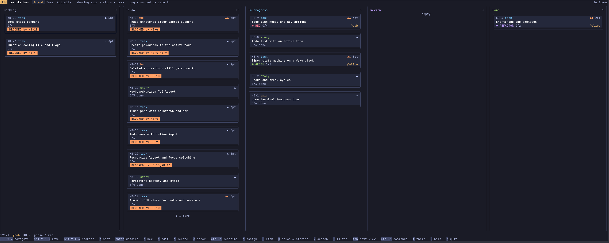
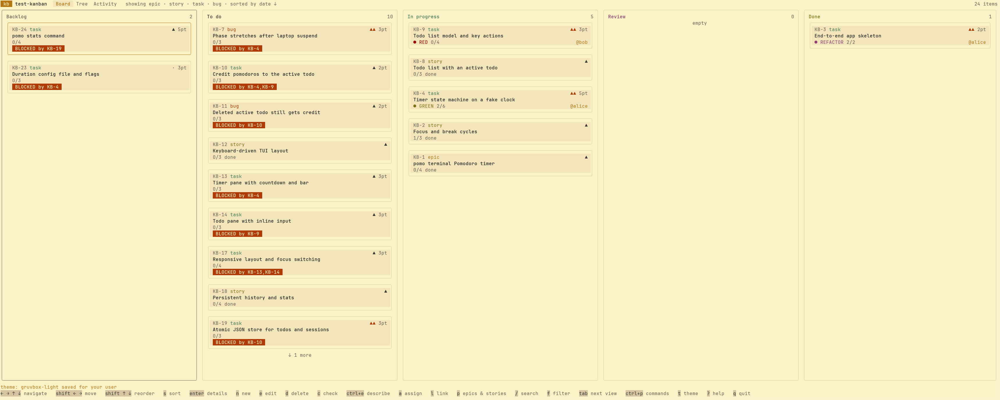

# kb

<p align="center">
  
  
</p>

A kanban board in the terminal for following agentic development. Coding
agents update the board through a CLI; the developer watches and steers the
work from a TUI that refreshes live.

- **One board per project**, stored in SQLite under `.kanban/` at the root
  of the main worktree, so every git worktree and every agent shares it.
- **Rules, not conventions**: an item moves to a column only when the
  column's requirements are met (tests passing, children finished, blockers
  done, acceptance criteria checked), and parents follow their children.
- **Colored tags**: a tag has a name and one of eight colors, is created once
  and shared by the whole board, and is managed from the CLI (`kb tag`) or
  the TUI.
- **Points that add up**: tasks and bugs carry story points; stories and
  epics show the sum of their tasks and bugs.
- **Built for agents**: atomic `kb next --claim`, claims that expire,
  optimistic versions, stable `--json` output and meaningful exit codes.

## Install

kb needs Go 1.26 or newer and no C toolchain.

```sh
go install github.com/CptPhenomeno/kb/cmd/kb@latest
```

Or from a clone:

```sh
make build        # static binary in bin/kb, version from git describe
make cross        # dist/kb-<os>-<arch> for linux and darwin, amd64 and arm64
```

## Quick start

```sh
cd your-project
kb init                                  # creates .kanban/ (kb.db is git-ignored)
kb add epic "Authentication"
kb add story "Token login" --parent KB-1
kb add task "Validate token in middleware" --parent KB-2 --points 3 \
  --test "rejects expired token" --status todo   # ready for kb next
kb                                       # open the TUI
```

New items start in Backlog; `kb next` picks from To do, Doing and Review.
`kb init --prefix API` chooses the ID prefix. `kb export` writes a readable
`.kanban/board.md` that you can commit next to the code.

## Working with agents

Paste the agent guide into the instructions your agents read:

```sh
kb guide >> CLAUDE.md                    # or AGENTS.md
```

Each agent names itself with `KB_ACTOR` and loops on one task at a time:

```sh
export KB_ACTOR=agent-auth
kb next --claim --json                   # take the best available task or bug
kb phase KB-3 red                        # failing tests first
kb test KB-3 fail 1
kb phase KB-3 green
kb test KB-3 pass 1
kb note KB-3 "validated the token in the middleware"
kb move KB-3 review                      # refused, with the reasons, until every test passes
```

`kb next` shows the best item that is available: in To do, Doing or Review,
not blocked, and (for tasks and bugs) without a valid claim, even your own.
Review comes first, then Doing, then To do; ties go to the higher priority, then to the item that unblocks the
heaviest chain of story points, then to the one with more points, its
position and its id. `--type` takes `epic`, `story`, `task` or `bug`
(default task and bug); `subtask` exits 3. `--claim` only claims tasks and
bugs, ignoring stories and epics (exit 3 if `--type` leaves neither), and a
task in review stays in review. Exit 2 means nothing is available.

Tags label cards and are shared by the board. `--tag` is repeatable on `kb
add` and `kb edit` (edit replaces the tags) and filters `kb list` and `kb next`;
the tags are created on first use. `kb tag` manages them:

```sh
kb tag list                              # name, color and card count, by name
kb tag add api --color blue              # red, orange, yellow, green, cyan, blue, purple or pink
kb tag color api green                   # recolor it on every card
kb tag rename api backend                # rename it on every card
kb tag delete backend                    # delete it and remove it from every card
```

A name has at most 24 characters and no comma, and is compared ignoring case.
Every `kb tag` command takes `--json` and `-q`. `--label` and the `labels`
field of a plan still work as deprecated aliases of `--tag` and `tags`.

Points belong to tasks and bugs only: an epic, a story or a subtask refuses
them. The points of a story or an epic are derived, the sum of its tasks and
bugs, and show in `kb show` and `kb tree` but are not a field of the item.

A planning agent turns `SPEC.md` into a YAML plan and imports it in one
transaction: `kb import plan.yaml --dry-run` validates it, `kb import
plan.yaml` creates it and `kb import plan.yaml --update` applies a revised
plan by `ref`. The format is in `kb guide`.

Scripts and agents should read `--json` output: its shape is documented in
[docs/cli-json.md](docs/cli-json.md). Exit codes: `0` ok, `1` error, `2` not
found, `3` requirements not met, `4` version conflict, `5` claimed by another
actor.

## The TUI

`kb` with no arguments opens three views, switched with `tab`:

- **Board**: five columns (Backlog, To do, In progress, Review, Done) with a
  detail panel on `enter`. `shift+←/→` moves a card when its requirements
  are met, otherwise an alert lists what is missing; `shift+↑/↓` reorders;
  `s` sorts the columns by date, ID or story points; `#` switches the lane
  counters and the total in the header between cards and points. In points
  only tasks and bugs count, so nothing is counted twice.
- **Tree**: the hierarchy with progress bars and points; `←/→` collapse and
  expand, `n` adds a child.
- **Activity**: each actor with its item, TDD phase and last write, beside
  the event stream; stale claims stand out and `a` releases them.

Arrows navigate everywhere (no vim keys). `n` creates, `e` edits (`ctrl+e`
opens `$EDITOR`), `d` deletes, `c` checks acceptance criteria, `a` claims or
releases, `l` manages links, `/` searches, `f` filters, `t` picks a theme,
`ctrl+p` opens the command palette and `?` lists every key.

Tags show as colored `⟨name⟩`, on the cards, in the detail and in the form.
In the form the tags field opens a selector: type to filter, `space` toggles a
tag, and typing a new name offers to create it (choose its color with `←/→`).
`ctrl+p` › **Manage tags** opens a popup to recolor, rename, create and delete
tags. Points of stories and epics are derived from their tasks and bugs and are
drawn in the color of the type, to tell them from the own points of a task.

`/` searches ID, title, tag and assignee (case-insensitive, words in AND) and
suggests tags, types and cards as you type: `↑/↓` choose, `enter` turns a tag or
type into an exact filter (`tag:api`, `type:bug`) and selects a card. You can
type the filters by hand; quote a value with spaces, as in `tag:"a b"`.

## Configuration

| Where | What |
| ----- | ---- |
| `.kanban/config.toml` | `prefix`, `claim_ttl` (default `15m`) and the project's default `theme`; versioned with the project. |
| `$XDG_CONFIG_HOME/kb/config.toml` | Your own preferences, saved by the TUI: `theme`, `show_parents`, `board_sort`, `board_counter` (`cards` or `points`, switched with `#`), `command_bar` (`compact` or `full`, chosen from the palette; the default is compact). |
| `KB_ACTOR` | Who you are; defaults to `@<git user>`. Names starting with `@` are people, any other name is an agent. |
| `KB_THEME` | Theme for this run, over the saved one. The default is `kb-neon-rain`. Dark: `kb-neon-rain`, `kb-synth-sunset`, `tokyo-night`, `catppuccin-mocha`, `gruvbox-dark`, `dracula`, `nord`, `solarized-dark`, `rose-pine`. Light: `kb-chrome-haze`, `kb-holo-dawn`, `catppuccin-latte`, `gruvbox-light`, `solarized-light`, `tokyo-night-day`, `dracula-alucard`, `rose-pine-dawn`, `nord-light`. |
| `KB_DIR` | Use the board in this directory instead of looking for the project root. |

## Development

```sh
make check        # gofmt, go vet, staticcheck, go test -race
```

Changes between versions are listed in [CHANGELOG.md](CHANGELOG.md).
