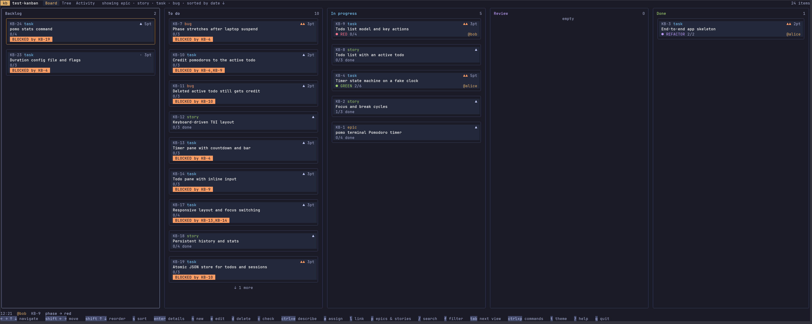
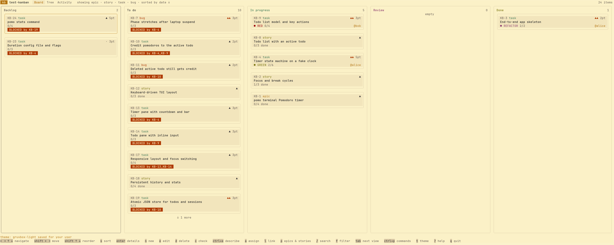

# kb

<p align="center">
  
  
</p>

A kanban board in the terminal for following agentic development. Coding
agents update the board through a CLI; the developer watches and steers the
work from a TUI that refreshes live.

- **One board per project**, stored in SQLite under `.kanban/` at the root
  of the main worktree, so every git worktree and every agent shares it.
- **Rules, not conventions**: an item moves to a column only when the
  column's requirements are met (tests passing, children finished, blockers
  done, acceptance criteria checked), and parents follow their children.
- **Built for agents**: atomic `kb next --claim`, claims that expire,
  optimistic versions, stable `--json` output and meaningful exit codes.

## Install

kb needs Go 1.26 or newer and no C toolchain.

```sh
go install github.com/CptPhenomeno/kb/cmd/kb@latest
```

Or from a clone:

```sh
make build        # static binary in bin/kb, version from git describe
make cross        # dist/kb-<os>-<arch> for linux and darwin, amd64 and arm64
```

## Quick start

```sh
cd your-project
kb init                                  # creates .kanban/ (kb.db is git-ignored)
kb add epic "Authentication"
kb add story "Token login" --parent KB-1
kb add task "Validate token in middleware" --parent KB-2 --points 3 \
  --test "rejects expired token" --status todo   # ready for kb next
kb                                       # open the TUI
```

New items start in Backlog; `kb next` hands out tasks and bugs from To do.
`kb init --prefix API` chooses the ID prefix. `kb export` writes a readable
`.kanban/board.md` that you can commit next to the code.

## Working with agents

Paste the agent guide into the instructions your agents read:

```sh
kb guide >> CLAUDE.md                    # or AGENTS.md
```

Each agent names itself with `KB_ACTOR` and loops on one task at a time:

```sh
export KB_ACTOR=agent-auth
kb next --claim --json                   # take the best available task or bug
kb phase KB-3 red                        # failing tests first
kb test KB-3 fail 1
kb phase KB-3 green
kb test KB-3 pass 1
kb note KB-3 "validated the token in the middleware"
kb move KB-3 review                      # refused, with the reasons, until every test passes
```

A planning agent turns `SPEC.md` into a YAML plan and imports it in one
transaction: `kb import plan.yaml --dry-run` validates it, `kb import
plan.yaml` creates it and `kb import plan.yaml --update` applies a revised
plan by `ref`. The format is in `kb guide`.

Scripts and agents should read `--json` output: its shape is documented in
[docs/cli-json.md](docs/cli-json.md). Exit codes: `0` ok, `1` error, `2` not
found, `3` requirements not met, `4` version conflict, `5` claimed by another
actor.

## The TUI

`kb` with no arguments opens three views, switched with `tab`:

- **Board**: five columns (Backlog, To do, In progress, Review, Done) with a
  detail panel on `enter`. `shift+←/→` moves a card when its requirements
  are met, otherwise an alert lists what is missing; `shift+↑/↓` reorders;
  `s` sorts the columns by date, ID or story points.
- **Tree**: the hierarchy with progress bars and points; `←/→` collapse and
  expand, `n` adds a child.
- **Activity**: each actor with its item, TDD phase and last write, beside
  the event stream; stale claims stand out and `a` releases them.

Arrows navigate everywhere (no vim keys). `n` creates, `e` edits (`ctrl+e`
opens `$EDITOR`), `d` deletes, `c` checks acceptance criteria, `a` claims or
releases, `l` manages links, `/` searches, `f` filters, `t` picks a theme,
`ctrl+p` opens the command palette and `?` lists every key.

## Configuration

| Where | What |
| ----- | ---- |
| `.kanban/config.toml` | `prefix`, `claim_ttl` (default `15m`) and the project's default `theme`; versioned with the project. |
| `$XDG_CONFIG_HOME/kb/config.toml` | Your own preferences, saved by the TUI: `theme`, `show_parents`, `board_sort`, `command_bar` (`compact` or `full`, chosen from the palette; the default is compact). |
| `KB_ACTOR` | Who you are; defaults to `@<git user>`. Names starting with `@` are people, any other name is an agent. |
| `KB_THEME` | Theme for this run, over the saved one: `tokyo-night`, `catppuccin-mocha`, `catppuccin-latte`, `gruvbox-dark`, `gruvbox-light`, `dracula`, `nord`, `solarized-dark`. |
| `KB_DIR` | Use the board in this directory instead of looking for the project root. |

## Development

```sh
make check        # gofmt, go vet, staticcheck, go test -race
```

Changes between versions are listed in [CHANGELOG.md](CHANGELOG.md).
